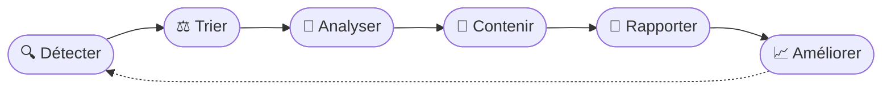

<!-- Bannière -->

  <a href="README.md">🇬🇧 English</a> · 🇫🇷 Français

  

  

---

## 👋 Salut

Moi c'est **Shyber**, **étudiante en école d'ingénieurs en cybersécurité**. La sécurité est le domaine que j'ai choisi, et j'y travaille en continu : labs, montage de réseaux, rapports d'incident et projets d'équipe. Ce qui me motive, c'est de comprendre comment une attaque se déroule vraiment, puis comment la repérer, l'arrêter et l'expliquer clairement.

Je me concentre sur la **Blue Team** : **SOC et détection**, **risques et conformité**, **sécurité réseau**, **sécurité du cloud**, **réponse à incident** et **gestion des vulnérabilités**.

J'aime aussi le côté **offensif**. Je l'apprends pas à pas avec des labs et des challenges CTF, parce que comprendre comment pensent les attaquants fait de moi une meilleure défenseuse.

---

## 🎯 Domaines d'intérêt

<table align="center">
  <tr>
    <td align="center" width="20%">
      <h3>🛡️</h3>
      <b>SOC & Détection</b> 
      Analyse de logs, requêtes SIEM, règles de détection d'intrusion
    </td>
    <td align="center" width="20%">
      <h3>🚨</h3>
      <b>Réponse à incident</b> 
      Investigation, playbooks, rapports d'incident clairs
    </td>
    <td align="center" width="20%">
      <h3>🌐</h3>
      <b>Sécurité réseau</b> 
      Analyse de trafic, pare-feu, segmentation, durcissement
    </td>
    <td align="center" width="20%">
      <h3>☁️</h3>
      <b>Sécurité du cloud</b> 
      Charges de travail cloud, conteneurs, journalisation et accès
    </td>
    <td align="center" width="20%">
      <h3>📋</h3>
      <b>Risques & Conformité</b> 
      Audits de sécurité, NIST CSF, RGPD, PCI DSS
    </td>
  </tr>
</table>

---

## 🧰 Boîte à outils

**Détection & analyse**

  
  
  
  
  
  

**Réseaux**

  
  
  
  
  

**Cloud & systèmes**

  
  
  
  
  
  

**Programmation**

  
  
  
  
  
  

---

## 🔬 Projets réalisés

<b>🛡️ Détection & analyse d'incidents</b>

 

| Projet | Ce que j'ai fait | Outils |
|---|---|---|
| **Analyse d'une attaque SYN flood** | Analyse d'une capture TCP, attaque remontée jusqu'à une IP externe, mesure de l'impact sur les clients légitimes et rédaction d'un rapport d'incident. | `Wireshark` `TCP` |
| **DDoS sur un serveur DNS** | Analyse des paquets capturés, documentation de l'incident et proposition de mesures correctives. | `tcpdump` |
| **Investigation d'un spear phishing** | Repérage des indicateurs (domaine usurpé, fautes d'orthographe, URL de collecte d'identifiants), vérification du hash d'un fichier suspect et application d'un playbook de réponse. | `VirusTotal` `Playbook` |
| **Règles de détection personnalisées** | Écriture de mes propres règles, passage de captures de paquets à travers celles-ci et analyse des logs produits. | `Suricata` |
| **Investigation de logs** | Recherche et corrélation d'événements de sécurité avec deux langages de requête différents. | `Splunk (SPL)` `Chronicle (YARA-L)` |
| **Labo SOC** | Projet d'équipe, que nous faisons grandir en combinant plusieurs de nos projets. Nous avons monté un réseau supervisé (un SIEM, un pare-feu, des postes Windows et Linux, des cibles vulnérables, une machine attaquante et une partie cloud), et nous recherchons et testons des scénarios d'attaque pour voir comment chacun est détecté. Nous apprenons en avançant et partageons ce que chacun découvre : toutes les idées sont les bienvenues. | `Wazuh` `pfSense` `Sysmon` `Kali Linux` `DVWA` `Metasploitable 2` `Docker` `Portainer` `Ubuntu Server` `Windows` `Google Cloud` |

<b>🌐 Réseaux & sécurité réseau</b>

 

| Projet | Ce que j'ai fait | Outils |
|---|---|---|
| **Réseau sécurisé 3 tiers** | Conception d'une architecture de campus complète avec deux accès Internet : routage en bordure, redondance au cœur et à la distribution, VLAN segmentés à l'accès. | `BGP` `OSPF` `VRRP` `NAT` |
| **Durcissement des équipements** | Sécurisation des switchs et routeurs : sécurité des ports, BPDU Guard, ACL, SSH limité aux chiffrements robustes, mots de passe chiffrés. | `Cisco IOS` |
| **VPN MPLS** | Construction d'un réseau d'opérateur où deux clients partagent les mêmes routeurs sans jamais voir le trafic l'un de l'autre. | `MPLS` `MP-BGP` `VRF` |
| **VRF-Lite** | Une topologie, de nombreuses variantes de routage (statique, RIP, OSPF, EIGRP, BGP, IS-IS, IPv4/IPv6), plus du routage inter-VRF. | `VRF` `IPv6` |

<b>☁️ Cloud & DevOps</b>

 

| Projet | Ce que j'ai fait | Outils |
|---|---|---|
| **Ordonnancement de tâches sur des VM cloud** | Écriture d'un ordonnanceur par séparation et évaluation (branch and bound) pour répartir des tâches sur plusieurs VM cloud. Il termine environ 22 % plus vite que le Round-Robin. | `Go` `Google Cloud` |
| **Pipeline CI pour une API** | Projet d'équipe : une petite API web avec un pipeline qui lance l'analyse du code, les tests automatisés et un rapport de couverture à chaque push. | `GitHub Actions` `Node.js` |

<b>⚙️ Systèmes & données</b>

 

| Projet | Ce que j'ai fait | Outils |
|---|---|---|
| **Programmation système bas niveau** | Processus, threads, gestion de la mémoire, synchronisation et communication inter-processus. | `C` `Linux` |
| **OS personnalisé basé sur Linux** | Projet d'équipe : création d'un système d'exploitation à partir d'une distribution Linux et du noyau Linux, adapté à nos besoins. | `Linux` |
| **Base de données de financement participatif** | Projet d'équipe : du besoin exprimé par le client à une base de données fonctionnelle et une application Python pour l'exploiter, en version relationnelle et NoSQL. | `SQL` `MongoDB` `Python` `PlantUML` |
| **Détection de fraude (ML)** | Entraînement de modèles sur un jeu de données très déséquilibré, où les cas importants sont rares. | `Python` `scikit-learn` |

<b>📋 Risques & conformité</b>

 

| Projet | Ce que j'ai fait | Référentiels |
|---|---|---|
| **Audit de sécurité interne (entreprise fictive)** | Évaluation de la conformité, remplissage d'une checklist de contrôles à partir de l'analyse de risques et rédaction de recommandations. | `NIST CSF` `RGPD` `PCI DSS` `SOC 1 & 2` |

---

## 🔄 Ma façon d'aborder un incident

Un bon rapport compte autant que l'analyse : il permet à quelqu'un d'autre de comprendre ce qui s'est passé et d'agir rapidement.

---

## 🏅 Certifications

  
  

---

## 🌱 Sur mon radar

- ☁️ Sécurité du cloud : sécuriser les charges de travail cloud et les conteneurs, et envoyer les journaux cloud dans notre labo SOC
- 🧪 Ajouter de nouveaux scénarios à notre labo SOC et publier un compte rendu pour chacun
- 🎯 Ingénierie de détection : écrire et affiner des règles, les relier à MITRE ATT&CK
- 🚩 Davantage de labs pratiques et de challenges capture-the-flag
- 🤖 Cybersécurité et IA

---

  <i>« Curieuse par nature, rigoureuse par habitude. »</i>

  

