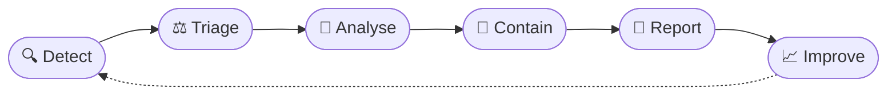

<!-- Header banner -->

  🇬🇧 English · <a href="README.fr.md">🇫🇷 Français</a>

  

  

---

## 👋 Hi there

I'm **Shyber**, a **cybersecurity engineering student**. Security is the field I chose, and I work on it all the time: labs, network builds, incident write-ups and team projects. What keeps me going is understanding how an attack really unfolds, and then how to spot it, stop it and explain it clearly.

My main focus is the **Blue Team**: **SOC and detection**, **risk and compliance**, **network security**, **cloud security**, **incident response** and **vulnerability management**.

And I enjoy the **offensive** side too. I'm learning it step by step through labs and CTF challenges, because knowing how attackers think makes me a better defender.

---

## 🎯 Areas of interest

<table align="center">
  <tr>
    <td align="center" width="20%">
      <h3>🛡️</h3>
      <b>SOC & Detection</b> 
      Log analysis, SIEM queries, intrusion detection rules
    </td>
    <td align="center" width="20%">
      <h3>🚨</h3>
      <b>Incident Response</b> 
      Investigation, playbooks, clear incident reports
    </td>
    <td align="center" width="20%">
      <h3>🌐</h3>
      <b>Network Security</b> 
      Traffic analysis, firewalls, segmentation, hardening
    </td>
    <td align="center" width="20%">
      <h3>☁️</h3>
      <b>Cloud Security</b> 
      Cloud workloads, containers, logging and access
    </td>
    <td align="center" width="20%">
      <h3>📋</h3>
      <b>Risk & Compliance</b> 
      Security audits, NIST CSF, GDPR, PCI DSS
    </td>
  </tr>
</table>

---

## 🧰 Toolbox

**Detection & analysis**

  
  
  
  
  
  

**Networking**

  
  
  
  
  

**Cloud & systems**

  
  
  
  
  
  

**Programming**

  
  
  
  
  
  

---

## 🔬 Projects I've worked on

<b>🛡️ Detection & incident analysis</b>

 

| Project | What I did | Tools |
|---|---|---|
| **SYN flood analysis** | Analysed a TCP capture, traced the attack to an external IP, measured the impact on legitimate clients and wrote an incident report. | `Wireshark` `TCP` |
| **DDoS on a DNS server** | Analysed the captured packets, documented the incident and proposed remediation. | `tcpdump` |
| **Spear phishing investigation** | Spotted the indicators (spoofed domain, spelling errors, credential-harvesting URL), checked a suspicious file hash and followed a response playbook. | `VirusTotal` `Playbook` |
| **Custom detection rules** | Wrote my own rules, ran packet captures through them and analysed the logs they produced. | `Suricata` |
| **Log investigation** | Searched and correlated security events with two different query languages. | `Splunk (SPL)` `Chronicle (YARA-L)` |
| **SOC lab** | Team project, which we keep growing by combining several of our projects. We built a monitored network (a SIEM, a firewall, Windows and Linux endpoints, vulnerable targets, an attacker machine and a cloud part), and we research and test attack scenarios to see how each one gets detected. We learn as we go and share what each of us finds: every idea is welcome. | `Wazuh` `pfSense` `Sysmon` `Kali Linux` `DVWA` `Metasploitable 2` `Docker` `Portainer` `Ubuntu Server` `Windows` `Google Cloud` |

<b>🌐 Networks & network security</b>

 

| Project | What I did | Tools |
|---|---|---|
| **Secure 3-tier network** | Designed a full campus architecture with two Internet links: routing at the edge, redundancy in the core and distribution, segmented VLANs at access. | `BGP` `OSPF` `VRRP` `NAT` |
| **Device hardening** | Locked down switches and routers: port security, BPDU Guard, ACLs, SSH limited to strong ciphers, encrypted passwords. | `Cisco IOS` |
| **MPLS VPN** | Built a provider network where two customers share the same routers without ever seeing each other's traffic. | `MPLS` `MP-BGP` `VRF` |
| **VRF-Lite** | One topology, many routing variants (static, RIP, OSPF, EIGRP, BGP, IS-IS, IPv4/IPv6), plus inter-VRF routing. | `VRF` `IPv6` |

<b>☁️ Cloud & DevOps</b>

 

| Project | What I did | Tools |
|---|---|---|
| **Task scheduling on cloud VMs** | Wrote a branch and bound scheduler to spread tasks over several cloud VMs. It finished about 22% faster than Round-Robin. | `Go` `Google Cloud` |
| **CI pipeline for an API** | Team project: a small web API with a pipeline that runs linting, automated tests and a coverage report on every push. | `GitHub Actions` `Node.js` |

<b>⚙️ Systems & data</b>

 

| Project | What I did | Tools |
|---|---|---|
| **Low-level systems programming** | Processes, threads, memory management, synchronisation and inter-process communication. | `C` `Linux` |
| **Custom Linux-based OS** | Team project: built an operating system from a Linux distribution and the Linux kernel, adapted to our needs. | `Linux` |
| **Crowdfunding database** | Team project: from the client's brief to a working database and a Python app to use it, in a relational and a NoSQL version. | `SQL` `MongoDB` `Python` `PlantUML` |
| **Fraud detection (ML)** | Trained models on a highly imbalanced dataset, where the cases that matter are rare. | `Python` `scikit-learn` |

<b>📋 Risk & compliance</b>

 

| Project | What I did | Frameworks |
|---|---|---|
| **Internal security audit (fictional company)** | Assessed compliance, completed a controls checklist from the risk assessment and wrote recommendations. | `NIST CSF` `GDPR` `PCI DSS` `SOC 1 & 2` |

---

## 🔄 How I think about an incident

A good report matters as much as the analysis: it lets someone else understand what happened and act on it quickly.

---

## 🏅 Certifications

  
  

---

## 🌱 On my radar

- ☁️ Cloud security: securing cloud workloads and containers, and bringing cloud logs into our SOC lab
- 🧪 Adding new scenarios to our SOC lab and publishing a write-up for each one
- 🎯 Detection engineering: writing and tuning rules, mapping them to MITRE ATT&CK
- 🚩 More hands-on labs and capture-the-flag challenges
- 🤖 Cybersecurity and AI

---

  <i>"Curious by nature, careful by habit."</i>

  

